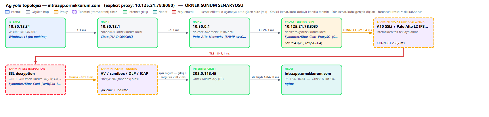
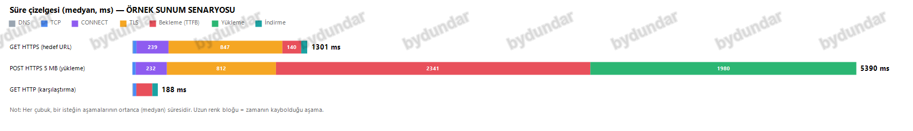
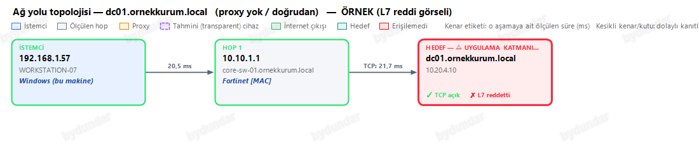
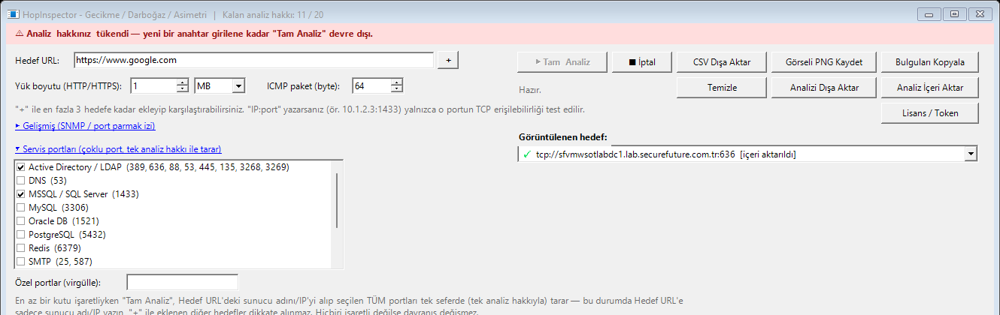
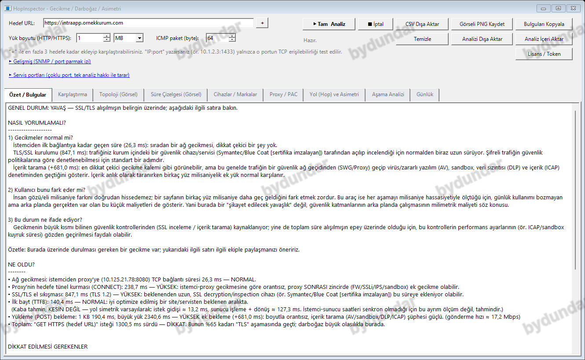
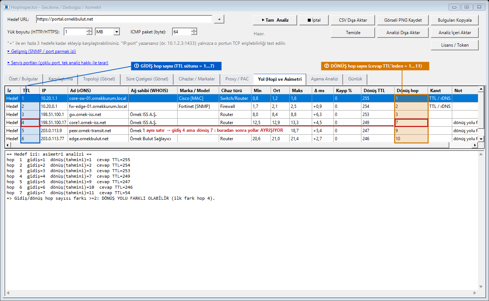

# HopInspector

**Kurumsal ağlarda gecikme, darboğaz ve asimetri teşhis aracı** — tek `.exe`, kurulum yok, yönetici hakkı gerekmez.

🇹🇷 Türkçe açıklama aşağıda, 🇬🇧 **[English description below](#english)**.

---

## 🇹🇷 Türkçe

### Ne sorunu çözüyor?

Karmaşık kurumsal ağlarda ("istemci → switch → firewall → proxy → SSL inceleme cihazı → içerik tarama → hedef sunucu" gibi uzun zincirlerde) bir bağlantının *neden* yavaş olduğunu bulmak zordur. HopInspector, bağlantıyı aşama aşama (DNS, TCP, proxy CONNECT, TLS, ilk bayt, yükleme/indirme) ölçüp, darboğazın **hangi aşamada ve muhtemelen hangi cihazda** olduğunu gösterir.

### Neleri tespit ediyor?

- **SSL/TLS inceleme (SSL inspection)** cihazları — sertifika imzalayıcısını karşılaştırarak
- **Proxy zinciri** ve proxy sonrası ek gecikme (SSLi/IPS/sandbox)
- **İçerik tarama** (AV/sandbox/DLP/ICAP) — yükleme boyutuyla orantısız bekleme üzerinden
- **Uygulama katmanı (L7) reddi** — port TCP olarak açık ama uygulama trafiği reddediliyorsa
- **Ağ yolu üzerindeki cihazlar** — traceroute + SNMP/MAC parmak izi ile marka/model tahmini
- **Servis portu taraması** — Active Directory/LDAP, DNS, MSSQL, MySQL, Oracle, PostgreSQL, Redis, SMTP, RDP, SSH, WinRM, SMB gibi yaygın servisleri tek tıkla, tek analiz hakkıyla tarama

### Ekran görüntüleri

*Tüm görüntülerdeki sunucu adları, IP adresleri ve bulgular tamamen uydurma örnek verilerdir.*

| Ağ yolu topolojisi | Süre çizelgesi |
|---|---|
|  |  |

| Uygulama katmanı (L7) tespiti | Servis portu taraması |
|---|---|
|  |  |

**Özet / Bulgular sekmesi — örnek analiz yorumu:**

**Yol (Hop) ve Asimetri sekmesi — gidiş ve dönüş aynı yoldan mı?**

Mavi sütun gidişte kaç hop attığınızı gösteriyor, burada 7. Turuncu sütun ise cevabın dönüşte kaç hop attığının tahmini; bunu cevap paketinin TTL değerine bakarak buluyoruz. İlk üç hopta ikisi de aynı, yani gidiş ve dönüş aynı yoldan. Dördüncü hopta gidiş 4 iken dönüş 7'ye zıplıyor. Cevap başka, daha uzun bir yoldan geri geliyor demek, yani trafik asimetrik.

Dönüşte tam olarak hangi cihazlardan geçtiğini göremiyoruz, sadece hop sayısındaki farktan bunu çıkarıyoruz. Kesin emin olmak istiyorsanız karşı uçtan da bir iz almanızı öneririz.

### Mimari ilkeleri

- **Tek `.exe`** — kurulum yok, kayıt defterine (registry) yalnızca lisans bilgisi yazar
- **Yönetici hakkı gerekmez**
- **Veri dışarı çıkmaz** — tüm ölçümler ve sonuçlar yerel kalır; dışa aktarma tamamen kullanıcı kontrolünde
- Sonuçlar istemci tarafı ölçümlerden çıkarımdır; transparent (L2 inline) cihazlar doğrudan görünmez, aşama süreleri ve parmak izlerinden dolaylı tahmin edilir

### Lisanslama

HopInspector **ücretsiz indirilip denenebilir** — uygulama açılır, tüm sekmeler/arayüz gezilebilir. Gerçek bir analiz çalıştırmak (**Tam Analiz**) için bir lisans anahtarı gerekir.

Lisans **süre bazlı** (ör. 30 gün) ya da **analiz hakkı (token) bazlı** olabilir; tamamen çevrimdışı çalışır, internet bağlantısı gerektirmez.

**Nasıl alınır:**
1. Uygulamayı açın, "Lisans / Token" ekranından kendi **Makine Token**'ınızı kopyalayın.
2. Token'ı [bo.dundar@outlook.com](mailto:bo.dundar@outlook.com) adresine gönderin.
3. Size özel üretilmiş anahtarı uygulamaya yapıştırın.

### Sistem gereksinimleri

Windows 10/11, .NET Framework 4.0+ (çoğu Windows kurulumunda hazır gelir).

### Gizlilik

Uygulama kişisel veri toplamaz/göndermez. Detaylar için [Gizlilik Politikası](https://claude.ai/artifact/XEKBFBNWqebZR3ecg7PVgX) sayfasına bakabilirsiniz.

---

## 🇬🇧 English

### What problem does it solve?

In complex corporate networks (client → switch → firewall → proxy → SSL-inspection appliance → content scanner → target server), figuring out *why* a connection is slow is hard. HopInspector measures each stage of a connection (DNS, TCP, proxy CONNECT, TLS handshake, time-to-first-byte, upload/download) and shows **which stage — and likely which device — is responsible for the bottleneck**.

### What it detects

- **SSL/TLS inspection appliances** — via certificate-issuer comparison
- **Proxy chains** and post-proxy latency (SSLi/IPS/sandbox devices)
- **Content scanning** (AV/sandbox/DLP/ICAP) — via upload-size-disproportionate delay
- **Application-layer (L7) rejection** — when a TCP port is open but the application itself refuses real traffic
- **Devices along the network path** — brand/model inference via traceroute + SNMP/MAC fingerprinting
- **Service port scanning** — scan common enterprise services (Active Directory/LDAP, DNS, MSSQL, MySQL, Oracle, PostgreSQL, Redis, SMTP, RDP, SSH, WinRM, SMB) in a single click, using a single analysis credit

**Path (Hop) & Asymmetry tab: does the traffic come back the same way it went?**

The blue column is how many hops the packet took on the way out (7 here). The orange column is our estimate of how many hops the reply took on the way back, worked out from the TTL of the reply packet. For the first three hops both are the same, so the path is symmetric. At hop 4 the outbound count is 4 but the return count jumps to 7, which means the reply is coming back over a different, longer route. That's asymmetric routing.

We can't see exactly which devices the reply went through, we only infer it from the difference in hop counts. If you need to be sure, take a trace from the other end too.

*All server names, IP addresses, and findings shown in the screenshots above are entirely fictional sample data.*

### Architecture principles

- **Single portable `.exe`** — no installer, only writes license data to the registry
- **No administrator rights required**
- **No data leaves your machine** — all measurements and results stay local; exporting is entirely user-initiated
- Results are inferred from client-side measurements; transparent (L2 inline) devices are never directly visible and are inferred indirectly from stage timing and fingerprints

### Licensing

HopInspector can be **downloaded and tried for free** — the application opens and its full UI is browsable. Running an actual analysis (**Full Analysis**) requires a license key.

Licenses are either **duration-based** (e.g. 30 days) or **usage/token-based**, and work fully offline — no internet connection required.

**How to get one:**
1. Open the app and copy your **Machine Token** from the "License / Token" screen.
2. Send the token to [bo.dundar@outlook.com](mailto:bo.dundar@outlook.com).
3. Paste the key you receive back into the application.

### System requirements

Windows 10/11, .NET Framework 4.0+ (preinstalled on most Windows systems).

### Privacy

The application does not collect or transmit personal data. See the [Privacy Policy](https://claude.ai/artifact/XEKBFBNWqebZR3ecg7PVgX) for details.

---

## İndirme / Download

En güncel sürüm için **[Releases](../../releases)** sekmesine bakın.
See the **[Releases](../../releases)** tab for the latest build.

## Lisans / License

Bu, ticari/kapalı kaynaklı bir yazılımdır. Kaynak kodu bu repoda bulunmaz; yalnızca derlenmiş uygulama dağıtılır. Ayrıntılar için [LICENSE](LICENSE) dosyasına bakın.

This is commercial, closed-source software. Source code is not included in this repository; only the compiled application is distributed. See [LICENSE](LICENSE) for details.
